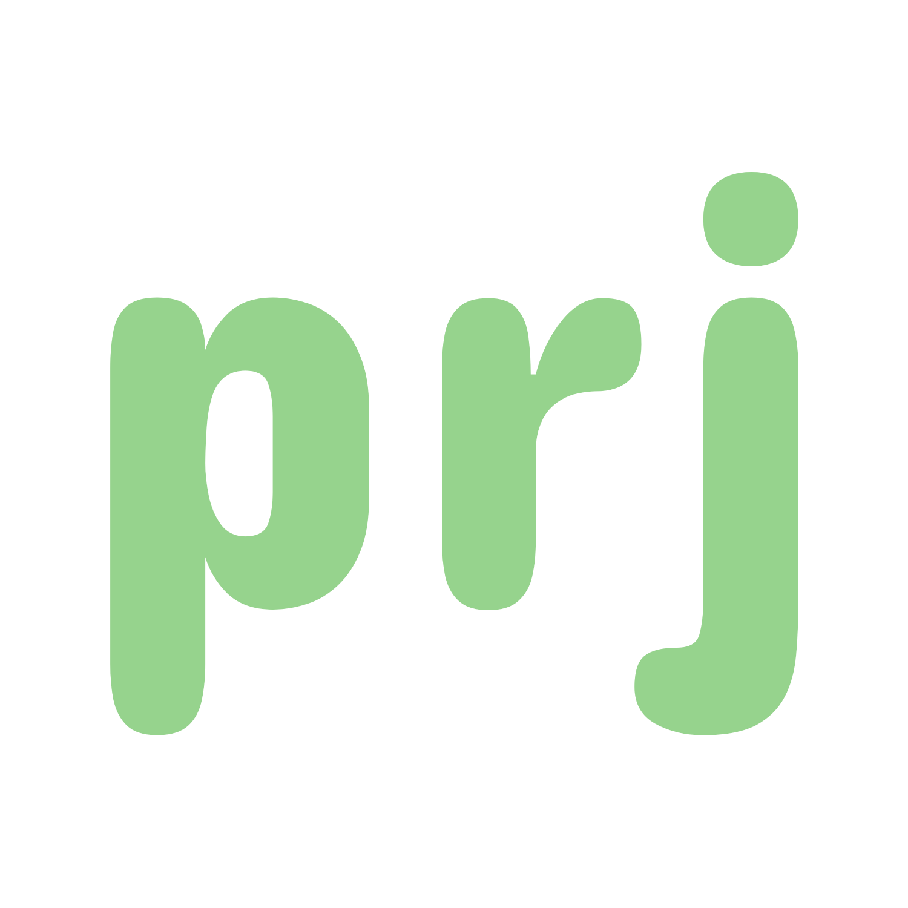

<p align="center">
    
</p>
  
<p align="center">
  <em>Opinionated todo-list application for the unix CLI.</em>
</p>

<p align="center">
    
  
  
</p>
  
<p align="center">
  <a href="#info">Info</a> •
  <a href="#install">Install</a> •
  <a href="#usage">Usage</a> •
  <a href="#license">License</a>
</p>  
  
---
<div id="info"></div>

## Info
  
**prj** is essentially a project organizer where each project contains a description, todo-list
as well as a list of freeform logs. This application was built for the explicit
purpose of learning/exploring the C# programming language.
  
### Requirements
- .NET 10
- Unix OS
- A terminal-based text editor
  
---
<div id="install"></div>

## Install
  
#### 1. Set environment variables (if not set already)
``` bash
# in ~/.bashrc (or whichever shell you're using):

export PATH="$HOME/.local/bin:$PATH"
export EDITOR="(your editor)"

# Remember restart your terminal session afterwards
```

#### 2. [Install .NET 10](https://learn.microsoft.com/en-us/dotnet/core/install/) (if not installed)

#### 3. Clone this repo and run the provided [install script](install.sh).
``` bash
git clone --depth=1 https://github.com/simon-danielsson/prj.git
cd prj
chmod +x install.sh
./install.sh
```

#### 4. Done
  
---
<div id="usage"></div>
  
## Usage
   
After installing, run `prj help` for details on usage.
    
---
<div id="license"></div>
  
## License
  
This project is licensed under the [MIT License](https://github.com/simon-danielsson/prj/blob/main/LICENSE).  

